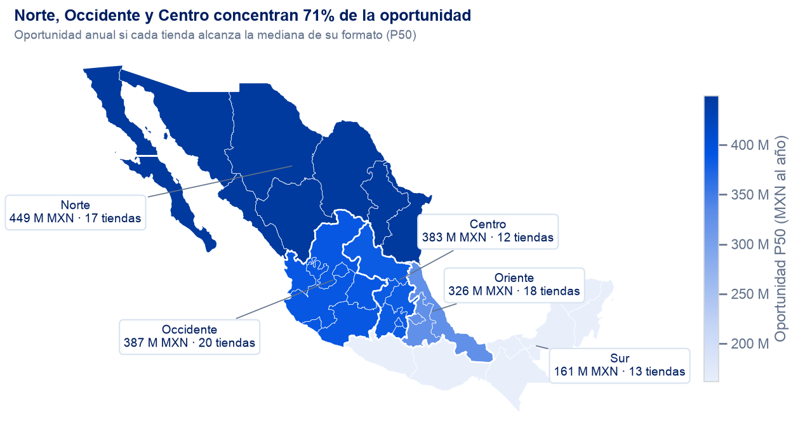

# retail-store-analytics-mx

Análisis de operaciones de una cadena de retail con **80 tiendas en 5 regiones de México**
(enero 2023 a febrero 2024, 6 categorías, ~204 mil registros diarios). El proyecto responde tres
preguntas de negocio, cada una conectada a una palanca distinta:

| Pregunta | Palanca | Resultado principal |
|---|---|---|
| **¿Cuánto voy a vender la próxima semana y cuánto reponer?** | Operar mejor | Un pronóstico LightGBM reduce **23% el error** frente al sistema de reposición actual en 18 semanas que ningún modelo vio, y en la simulación de pedido evita **711 M MXN** entre venta perdida y sobreinventario |
| **¿Qué tiendas venden menos de lo que deberían?** | Crecer | Llevar cada tienda a la mediana de sus pares vale **~1,700 M MXN al año** (+5.7%); 27 tiendas tienen capacidad ociosa y la palanca es comercial |
| **¿Las promociones funcionan?** | Dejar de gastar | **No mueven la venta**: efecto de −0.2% (IC 95%: −0.4% a 0.0%) en 6,953 M MXN de venta promocionada, sin descuento medible |

**Resultado de la pregunta 2 (potencial de tiendas): dónde está la oportunidad.** Detalle en el
[notebook 04](notebooks/04_potencial_tiendas.ipynb).



Antes de modelar se encontraron **dos campos del sistema que llevan a conclusiones falsas**:
la señal de reposición usa la venta del día siguiente, y el conteo de transacciones viene inflado
~22% en días de promoción. Ambos se corrigen o excluyen en todo el proyecto.

## Cómo navegar el repositorio

| Para... | Consultar |
|---|---|
| Ver la historia completa en 20 minutos | [reports/presentacion_ejecutiva.pdf](reports/presentacion_ejecutiva.pdf) |
| Entender los datos y cómo se definió el problema | [notebooks/01_eda.ipynb](notebooks/01_eda.ipynb) |
| Ver el pronóstico, la comparación de modelos y el impacto en MXN | [notebooks/02_pronostico.ipynb](notebooks/02_pronostico.ipynb) |
| Ver la evaluación de promociones | [notebooks/03_promociones.ipynb](notebooks/03_promociones.ipynb) |
| Ver el potencial de tiendas, el mapa y la matriz | [notebooks/04_potencial_tiendas.ipynb](notebooks/04_potencial_tiendas.ipynb) · [mapa interactivo](reports/figures/mapa_potencial_regional.html) (descargar y abrir en el navegador) |
| Revisar por qué se tomó cada decisión | [docs/decisiones.md](docs/decisiones.md) |
| Leer la ficha del modelo y cómo se operaría | [MODEL_CARD.md](MODEL_CARD.md) |
| Saber cómo se trabajó y cómo se usó IA | [PROCESS.md](PROCESS.md) |

Los notebooks se leen de arriba abajo: cada sección abre con una pregunta y cierra con una
decisión o conclusión. La lógica vive en `src/retail_analytics/` y tiene pruebas automáticas.

## Notebooks y scripts: qué es cada cosa

| | Notebooks (`notebooks/`) | Scripts (`src/retail_analytics/`) |
|---|---|---|
| Para qué | Ver el análisis: gráficas, tablas y conclusiones | Correr el análisis sin intervención; es el código que se llevaría a producción |
| Contienen lógica | No: importan las funciones de los scripts | Sí: limpieza, variables, modelos, métricas y análisis, con docstrings y pruebas |
| Cómo se corren | Jupyter o VS Code | Terminal: `make forecast`, `make predict`, `make promotions`, `make potential` |

**Cómo se llevaría el pronóstico a producción.** La propuesta completa está en
[MODEL_CARD.md](MODEL_CARD.md#cómo-se-operaría). En resumen:

1. **Un comando de predicción semanal (ya incluido: `make predict`).** `pipeline.py` evalúa y
   elige el modelo en el histórico; `predict.py` entrena ese modelo con toda la historia y escribe
   el pronóstico de los próximos 7 días por tienda × categoría. Usa las mismas funciones que el
   backtest; una prueba verifica que, con los datos cortados en una semana de prueba, reproduce el
   pronóstico del backtest. El calendario futuro (quincenas, festivos de fecha fija, lunes de la
   Ley Federal del Trabajo, Semana Santa y Buen Fin) se genera con reglas que reproducen las 425
   fechas del calendario real.
2. **Datos en la nube.** Los datos se leen desde Cloud Storage (ya soportado con `RAW_DATA_URI`)
   y se validan con los contratos de `contracts.py` antes de entrenar; si fallan, no se publica
   el pronóstico y se usa el sistema actual como respaldo.
3. **Un job programado** cada domingo (por ejemplo, un contenedor con `uv.lock` en Cloud Run o
   Vertex AI) que corra `make predict` y entregue la tabla al sistema de reposición. Este paso y
   el siguiente son la propuesta; no están implementados en el repositorio.
4. **Seguimiento y monitoreo.** Cada corrida queda registrada en MLflow; el WAPE y el sesgo
   semanales por formato y región se comparan contra el sistema actual, con alertas si el
   modelo deja de ganarle.

## Cómo correrlo

Los resultados del pronóstico ya vienen en `data/processed/`: basta con preparar el entorno y abrir
los notebooks. Las mismas instrucciones se prueban en Windows y Linux en cada commit (CI).

**1. Instalar [uv](https://docs.astral.sh/uv/)** (una sola vez). uv instala Python 3.12 y las
versiones exactas de librerías fijadas en `uv.lock`; no hace falta tener Python instalado.

```powershell
# Windows (PowerShell); después cerrar y abrir la terminal
powershell -ExecutionPolicy ByPass -c "irm https://astral.sh/uv/install.ps1 | iex"
```

```bash
# Mac / Linux
curl -LsSf https://astral.sh/uv/install.sh | sh
```

**2. Correr desde la carpeta del repositorio.** `make.bat` (Windows) y `Makefile` (Mac/Linux) tienen
los mismos comandos.

| Paso | Windows (PowerShell o cmd) | Mac / Linux |
|---|---|---|
| Preparar el entorno | `.\make.bat setup` | `make setup` |
| Correr las 48 pruebas (incluye checksum y contratos de los CSV) | `.\make.bat test-all` | `make test-all` |
| Correr el pronóstico completo (opcional, ~30 min) | `.\make.bat forecast` | `make forecast` |
| Pronosticar los próximos 7 días (~10 s) | `.\make.bat predict` | `make predict` |
| Correr el análisis de promociones (~10 s) | `.\make.bat promotions` | `make promotions` |
| Correr el análisis de potencial de tiendas (~5 s) | `.\make.bat potential` | `make potential` |
| Re-ejecutar el notebook de EDA (opcional) | `.\make.bat eda` | `make eda` |

**Qué produce cada script.** Todos leen los CSV crudos y no dependen de ningún notebook.

| Script | Comando directo | Salidas en `data/processed/` | Resumen que imprime |
|---|---|---|---|
| Pronóstico | `python -m retail_analytics.pipeline` | `validation_*.csv` (selección y ajuste), `test_predictions.parquet`, `test_model_selection.csv`, `forecast_setup.json`; corridas en MLflow | Avance por etapa y modelo elegido |
| Predicción | `python -m retail_analytics.predict` | `pronostico_proxima_semana.csv` (tienda, categoría, fecha, unidades) | Fechas pronosticadas y total de unidades: 1 al 7 de marzo de 2024, 3.46 M (última semana real: 3.42 M) |
| Promociones | `python -m retail_analytics.analyses promotions` | `promociones_efectos.csv`, `promociones_segmentos.csv` | Efecto en monto vendido: −0.22% (IC 95%: −0.43% a 0.00%) |
| Potencial | `python -m retail_analytics.analyses potential` | `potencial_oportunidad.csv` | Oportunidad P50 1,707 M MXN · P75 4,420 M MXN · 17 tiendas |

Las pruebas (`test-all`) verifican que la predicción reproduce el backtest y que los scripts de promociones y potencial reproducen esas cifras. La predicción usa el modelo elegido por el pronóstico (`forecast_setup.json`).

**3. Abrir los notebooks** con `uv run jupyter lab`, o en VS Code eligiendo el kernel
**retail-analytics (.venv)**. Cada corrida del pipeline queda registrada en MLflow:
`uv run mlflow ui --backend-store-uri sqlite:///mlflow.db`.

**Sin uv (solo pip, Python 3.11 o 3.12).** `requirements.txt` tiene las mismas versiones que
`uv.lock` (CI verifica que coincidan):

```bash
python -m venv .venv
.venv\Scripts\activate            # Mac / Linux: source .venv/bin/activate
pip install -r requirements.txt
pip install -e . --no-deps
pytest
```

**Datos en la nube.** Por defecto se leen de `data/raw/`. Para leerlos de Google Cloud Storage,
copia `.env.example` a `.env`, define `RAW_DATA_URI=gs://...` e instala el extra
`uv sync --extra gcs` (con pip: `pip install gcsfs`). Las credenciales se pasan solo por variables de entorno.

## Estructura

```
pyproject.toml, uv.lock dependencias y versiones fijadas (requirements.txt: la misma lista para pip)
Makefile, make.bat      atajos de comandos (Mac/Linux y Windows)
configs/config.yaml     rutas, horizonte del pronóstico, semanas de validación y prueba, columnas prohibidas
data/raw/               datos originales, inmutables, con checksum (MANIFEST.sha256)
data/external/          polígonos de estados (solo para el mapa; fuente en su README)
data/processed/         resultados del pronóstico (se versionan para no esperar 30 min; make forecast los regenera)
docs/                   diccionario de datos y bitácora de decisiones
notebooks/              01 EDA · 02 pronóstico · 03 promociones · 04 potencial
reports/                presentación ejecutiva (PDF) y mapa (interactivo y estático)
src/retail_analytics/
  io.py, config.py      carga de datos (local o gs://) y configuración
  contracts.py          contratos de datos (pandera)
  quality.py            diagnósticos de calidad
  cleaning.py           limpieza y reconstrucción de campos
  features.py           variables del pronóstico (todas con rezago ≥ 7 días)
  forecast.py           modelos y backtest con origen móvil
  evaluate.py           métricas, impacto en MXN y regla de elección de modelo
  pipeline.py           selección, ajuste y comparación (make forecast) + MLflow
  predict.py            pronóstico de los próximos 7 días con el modelo elegido (make predict)
  analyses.py           promociones y potencial desde la terminal (make promotions / make potential)
  promotions.py         promociones como experimento (efectos fijos, potencia, segmentos)
  potential.py          potencial de tiendas (consulta SQL en DuckDB + regresión)
  viz.py                estilo de gráficas (paleta validada para daltonismo)
tests/                  pruebas unitarias, de fuga de información y de integridad de datos
```

## Limitaciones principales

- Los datos empiezan en enero de 2023: casi todos los festivos de la prueba eran los primeros de
  su tipo. En días sin festivo el modelo reduce el error 30% (28.4% vs 40.5%); en festivos nuevos
  de celebración puede ser peor que el sistema actual. Agrupar festivos por familia mejora los 11
  festivos de la prueba (análisis exploratorio, notebook 02 §10).
- El impacto en MXN del pronóstico es una simulación (no hay datos de inventario, agotados ni
  costos); se propone confirmarlo con un piloto con grupo control.
- Las tiendas no tienen ubicación: el mapa es por región, con una asignación de estados que es un
  supuesto documentado y no cambia ninguna cifra.
